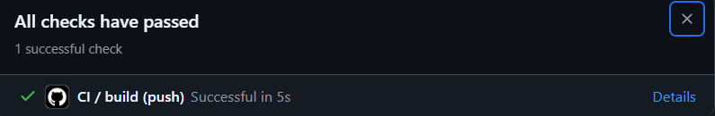

# PROG6212-RaceDayPOE

This is an individual project built progressively across three parts. The three parts come together to produce a fully containerised, cloud-aware, API-driven platform that reflects real-world software development practices.

RaceDay is a race event management platform that allows Organisers to create and manage running events, venues, and categories, while Participants can browse events and enrol in categories of their choice.

- **YouTube Part 1:** https://youtu.be/bsr2mjv3woo
- **GitHub:** https://github.com/mahleSoftdev/PROG6212-RaceDayPOE

## Project Overview

RaceDay allows event Organisers to publish running events at specific venues, break each event into distance-based categories (e.g. 5km, 10km, Half Marathon), and allow Participants to enrol in a category of their choice. Once an event has taken place, results (finish time and position) can be recorded against each participant's enrolment.

The system is built around a relational database (`racedayDB`) with the following core entities: **Users**, **Venues**, **Events**, **Categories**, **Enrolments**, and **Results** — exposed through a RESTful API.

---

## User Roles

The platform is built around two application roles:

### 🏁 Organiser
An Organiser is a user responsible for creating and managing events, venues, and everything associated with them.

An Organiser can:
- Create, update, and delete events they own
- Create, update, and delete categories within their own events
- Create, update, and delete venues
- View all participants enrolled in their events
- Record, update, and delete race results for participants in their events
- View any user's profile

### 🏃 Participant
A Participant is a member of the public who registers an account to take part in races.

A Participant can:
- Browse all publicly available events, venues, and categories
- Enrol in a category for a specific event
- View and cancel their own enrolments
- View their own race results across events they've participated in

> `Public` and `Authenticated` in the API plan describe access levels, not roles — every account is created with one of the two roles above. See [`docs/API_Plan.pdf`](docs/API_Plan.pdf) for the full breakdown of role-based access per endpoint.

## Setup Instructions

### Prerequisites

Before running this project, make sure you have the following installed:

- [.NET 8 SDK](https://dotnet.microsoft.com/download) (or the version used in this project)
- [SQL Server](https://www.microsoft.com/sql-server) (Developer or Express edition) or SQL Server hosted via Docker
- [SQL Server Management Studio (SSMS)](https://learn.microsoft.com/sql/ssms/download-sql-server-management-studio-ssms) (recommended, for running the database script)
- [Git](https://git-scm.com/)
- An IDE such as [Visual Studio](https://visualstudio.microsoft.com/) or [VS Code](https://code.visualstudio.com/)

## API Overview

The full list of endpoints, HTTP methods, required roles, request bodies, and expected responses is documented in [`docs/API_Plan.pdf`](docs/API_Plan.pdf).

At a high level, the API exposes endpoints for:

| Resource | Description | Roles Involved |
|---|---|---|
| `/api/auth` | User registration and login | Public |
| `/api/users` | User profile management | Authenticated, Organiser |
| `/api/events` | Creating, viewing, updating, and deleting events | Public, Organiser |
| `/api/categories` | Managing race categories per event | Public, Organiser |
| `/api/enrolments` | Participant enrolments into categories | Participant, Organiser |
| `/api/results` | Recording and retrieving race results | Participant, Organiser |
| `/api/venues` | Managing race venues | Public, Organiser |

Authentication is handled via bearer tokens issued at login, with role-based authorization enforced per endpoint. Only two application roles exist: **Organiser** and **Participant**.

---

## CI/CD Pipeline

This project uses **GitHub Actions** to automatically validate the repository on every push and pull request to `main`. The workflow (`.github/workflows/ci.yml`) checks that:

- The `docs` folder exists
- Required submission files are present (`API_Plan.pdf`, `ERDDIAGRAM_drawio.png`, `Part_1.sql`, `README.md`)
- The SQL script contains valid `CREATE TABLE` statements

**CI/CD run screenshot:**

---

## Video Demonstration

An unlisted YouTube video demonstrating the running API, code structure, endpoints, authentication, and unit tests can be found here:

📺 **[Watch the demo video](https://youtu.be/bsr2mjv3woo)**

---
